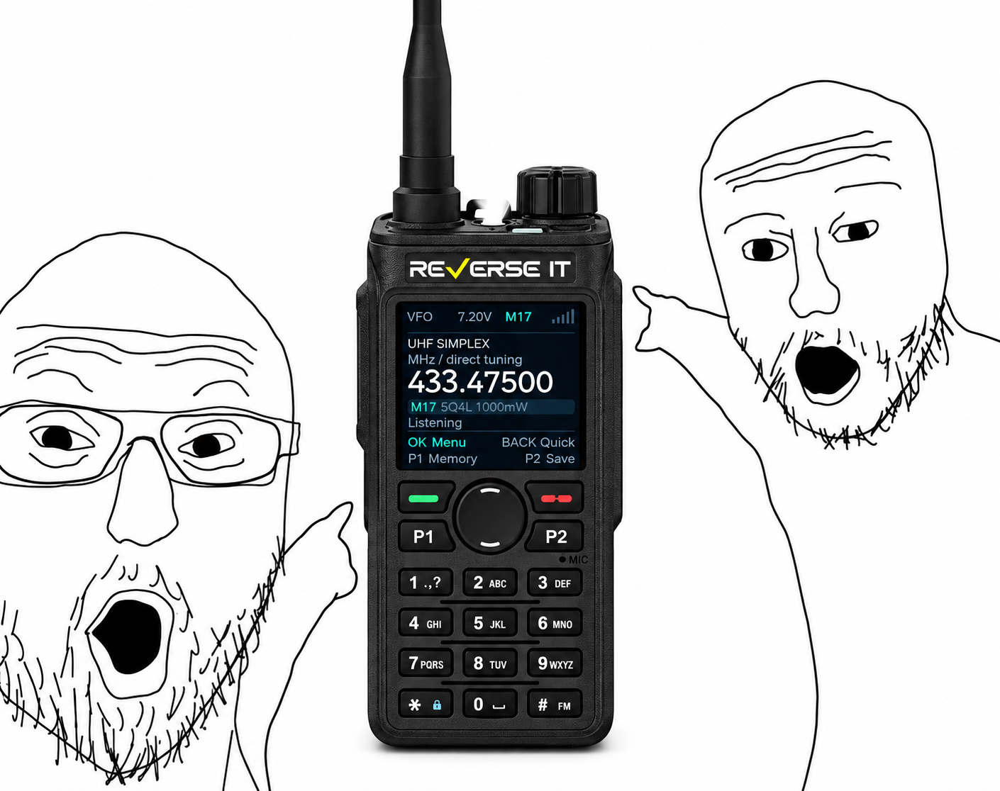
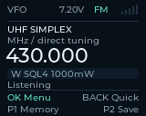
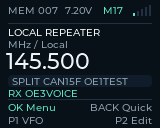
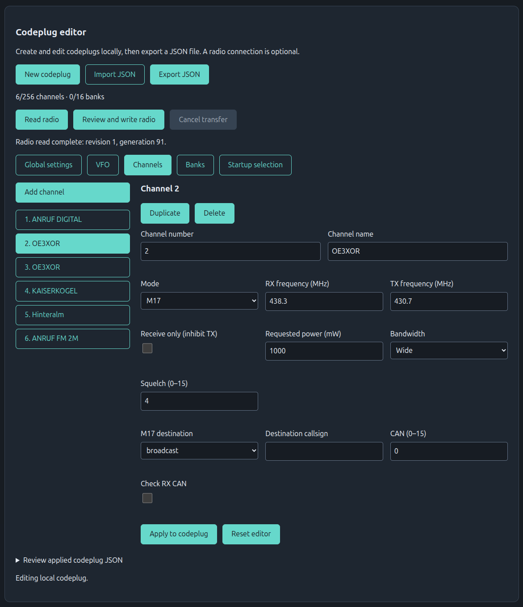
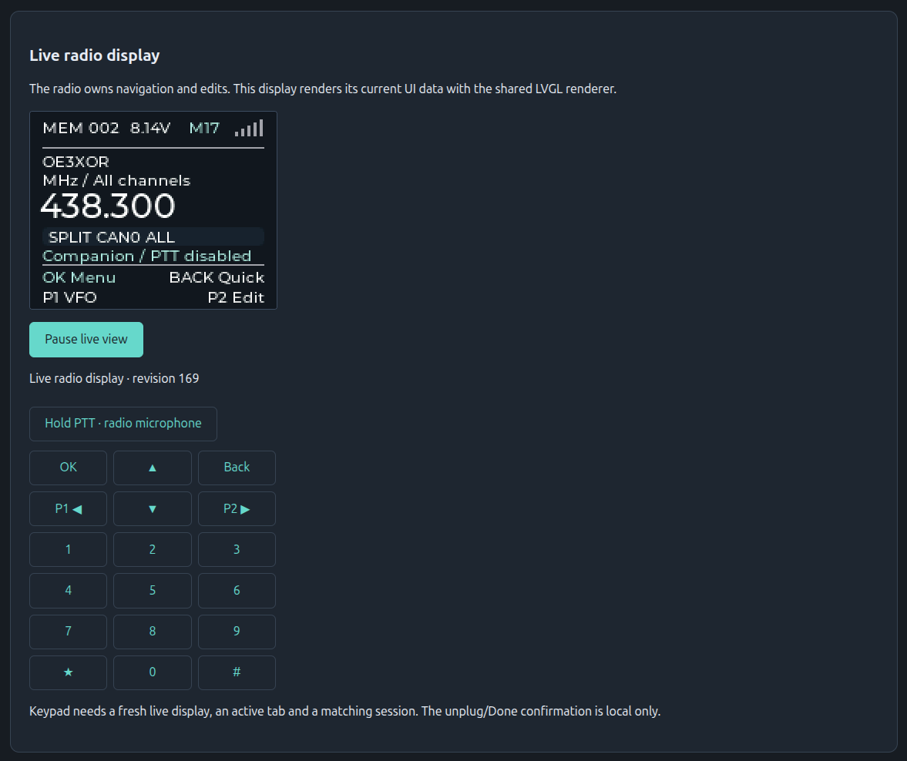
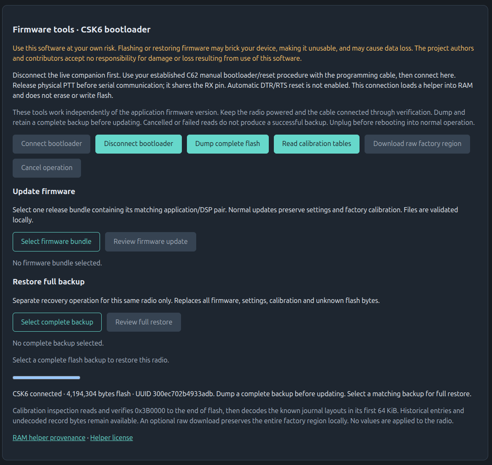

# OE3ANC HT

Experimental FM/M17 firmware for the C62 handheld, with a web companion and a
desktop emulator.

[Web companion](https://ht.oe3anc.at/) ·
[Releases](https://github.com/OE3ANC/oe3anc-ht/releases)

## Project status and disclaimer

This is experimental firmware that I develop and maintain for my personal use.
It provides a platform for testing ideas on the C62 and evaluating and improving
AI-assisted development workflows. AI tools are used extensively in development.

Ideas are welcome, but feature requests are not accepted, and fixes for reported
issues are not guaranteed. Continued maintenance depends on my interest in the
project; development may be discontinued.

Use it entirely at your own risk. Flashing or restoring may brick your radio or
lose data. I, and other authors and contributors, accept no responsibility for
broken devices, data loss or any other damage or harm.

For actual use, I recommend the better-designed and more stable
[OpenRTX](https://openrtx.org/). If you want to contribute to or support open-source
radio, support [M17](https://m17project.org/) and [OpenRTX](https://openrtx.org/).

## Quick-start

1. Download the firmware ZIP for your chosen [release](https://github.com/OE3ANC/oe3anc-ht/releases)
   and extract `firmware-bundle.json`.
2. Open the [web companion](https://companion.oe3anc.at/) in a desktop browser
   with Web Serial support. Use the companion version matching your firmware release.
3. Put the C62 in manual bootloader mode and connect its programming cable.
   Release physical PTT, then select **Connect bootloader** under **Firmware tools**.
   Use **Dump complete flash** and keep the backup before updating.
4. Select `firmware-bundle.json`, choose **Review firmware update**, and select
   the application/DSP pair for the first installation. Review and acknowledge
   the prompts, then flash. Keep the radio powered and connected until completion.
5. Disconnect the bootloader, unplug the cable and reboot the radio. Reconnect the cable, then select
   **Connect** in the matching web companion. Use the codeplug editor to program
   channels or the live display and virtual keypad to control the radio.
   UART and physical PTT stay available without a mode switch. Physical PTT
   activates after a 300 ms hold; shorter shared-pin pulses are UART activity.

If the radio reports **Storage is read-only** with **Load error -134** after using
an earlier development firmware, retain a complete flash backup and use
**Firmware tools → Review settings reset**. This deletes saved settings, channels
and banks, preserves firmware and factory calibration, and verifies the reset.
Disconnect, unplug and reboot, then read the radio again before uploading a codeplug.
Normal firmware updates preserve settings and do not clear this error.

Before downgrading firmware, export your codeplug and keep a complete flash backup;
older firmware may not read settings saved by newer versions.

## Features

### Firmware

- FM with independent RX/TX CTCSS or DCS and adjustable CTCSS transmit level.
- [M17](https://m17project.org/) digital voice with Codec2-mod 3200, callsign
  addressing and CAN filtering.
- VFO and Memory operation, separate RX/TX frequencies, 256 channels and 16
  ordered banks. Edit them on the radio or share a JSON codeplug.
- Selectable transmit power of 1, 2.5 or 5 W (provisional settings, not measured output).
- Seven display themes, adjustable contrast, idle backlight dimming, keypad lock,
  an optional startup animation and chime, and a transmit time limit.
- Physical PTT and companion connection available without a mode switch;
  PTT activates after a 300 ms hold.
- Desktop emulator for exploring the radio interface.

### Browser-based companion

- Offline and connected channel programming

- Live radio display and virtual keypad

- Firmware updates, complete flash backups and read-only factory calibration inspection

## Controls and menus

From Home, **OK** opens the main menu and **PTT2** toggles Quick controls.
Quick controls contain the current VFO/channel editor, FM squelch, Monitor and
Listen on TX. Monitor and Listen on TX are temporary toggles; changing channel
or VFO clears them. Listen on TX receives the repeater input with FM tone
filtering and squelch bypassed. Transmit frequency and restrictions stay unchanged.

| Menu | Contents |
| --- | --- |
| VFO Settings / Edit current channel | RX/TX frequencies and channel settings; Apply/Save, Save as channel or Duplicate/Delete |
| Channels / Banks | Browse, select and edit channels and ordered banks |
| Radio | VFO / Memory, VFO step, local callsign, TX limit |
| Appearance | Theme, contrast, motion, startup animation and chime |
| Backlight | Active brightness, idle delay and dim brightness |
| Status | Radio, mode, activity, battery and storage |
| Development | BK4819 diagnostics, FM tuning, LNA polarity, Codec2 statistics and RX register pages |

**Up/Down** selects a row, or changes a value after **OK** starts editing.
**OK** accepts the field; **Back** cancels it. **P1/P2** always mean previous/next
page. In text fields, Up/Down moves the cursor, **\*** erases and **#** finishes
the current character; frequencies have a fixed decimal point. Choose Save or
Apply once to commit the form. Replacement and deletion require confirmation;
Back from a changed form offers Save/Apply, Discard or Continue editing.
PTT uses the last applied configuration and returns to the draft after release.
Any key skips the startup animation; its Appearance switch controls both animation
and chime, independently of ordinary menu motion.

## Acknowledgements

Thanks to everyone involved in reverse-engineering the C62, the OpenRTX
contributors, and the authors of the BK4819 driver and C62 integration we copied and
adapted as well as to ListenAI for their help with the DSP firmware. Their work
made this project possible. Imported code retains its original attribution and licenses.

Thanks also to David Rowe and the Codec2 contributors for Codec2, and Wojciech Kaczmarski SP5WWP and 
Silvano Seva IU2KWO for their work and ideas in [Codec2-mod](https://github.com/M17-Project/Codec2-mod).

We encourage amateur-radio manufacturers to publish tools, documentation and
schematics so the open-source community can develop innovative firmware and
extend the capabilities of existing hardware.

Project code uses GPL-3.0-or-later; see [license](LICENSES/GPL-3.0-or-later.txt) and the attribution above.

Automated tests are currently disabled in CI and tagged release builds via
`tools/check_ci.py --skip-tests`. Firmware and companion builds and release
identity checks still run. Test sources remain available; omit `--skip-tests`
to run the complete checks manually.

### Automatic nightly builds

Every push to `main` builds and deploys the latest firmware/companion pair to
[/nightly/](https://ht.oe3anc.at/nightly/). The companion shows the UTC build date
and links to `firmware-nightly.zip` beside it. These files replace the previous
nightly; no nightly GitHub Release or moving tag is created. Use the firmware
and companion from the same build, since their exact identity is still checked.

Only version-tag pushes create versioned release drafts. Publishing a tagged
release preserves its archived companion and the latest nightly. Pages deployments
are serialized and always build the current default branch, including release
publication/retries, so an older event cannot replace nightly with an older commit.
The existing GitHub Pages environment must permit automatic deployment without
required reviewers; the workflow itself has no approval or manual publish step.
